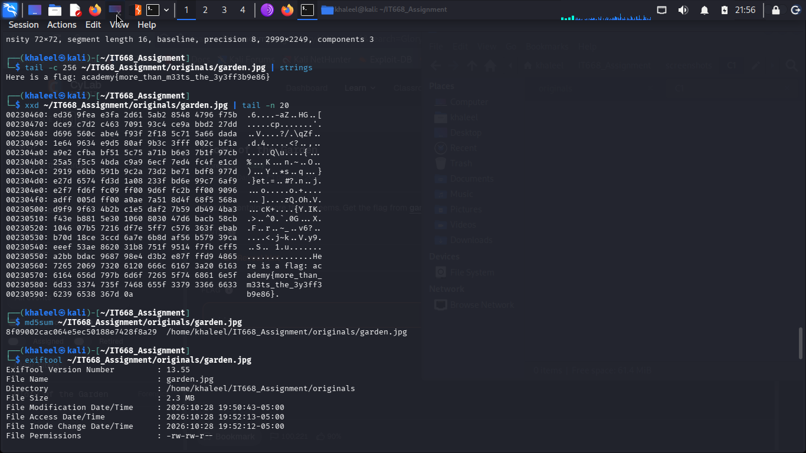
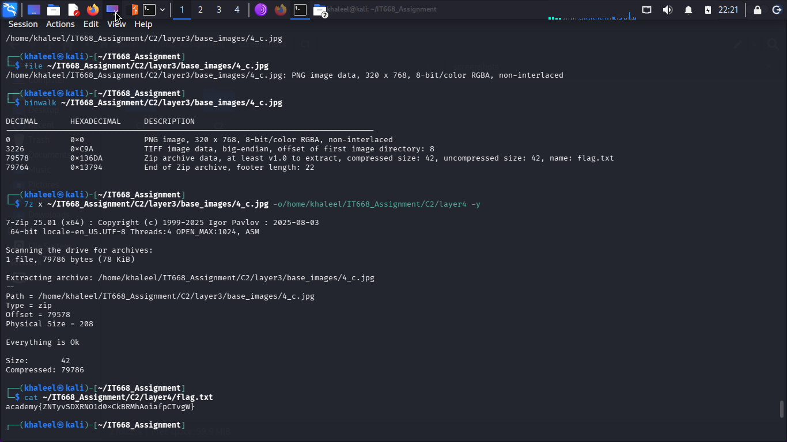
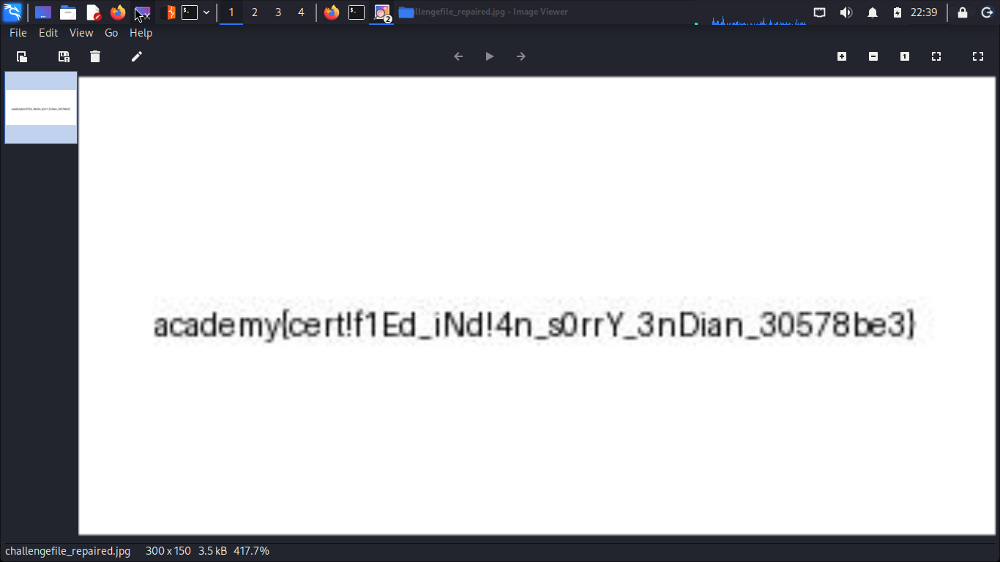

# IT668 CTF Assignments — Hidden Data in Images

A digital forensics assignment for **IT668**, focused on identifying hidden data in image files, examining file structures, and recovering challenge artifacts using Kali Linux.

## Overview

This repository contains the investigation results for three challenges:

| Challenge | Investigation focus | Result |
|---|---|---|
| C1 — Garden | JPEG structure and data appended after the image's End of Image marker | Hidden data identified |
| C2 — Dolls | File signature verification and nested archive extraction | Hidden content recovered |
| C3 — Challenge File | File structure repair and byte-order analysis | Repaired JPEG recovered |

## Techniques Used

### C1 — Garden
- Inspected the file structure and trailing bytes.
- Examined the JPEG End of Image (EOI) marker.
- Used command-line analysis to identify data appended after the image data.
- Recorded the findings in `report/C1_results.txt`.

### C2 — Dolls
- Verified the actual file format instead of relying on the filename extension.
- Examined embedded and nested archive structures.
- Extracted successive archive layers to recover the challenge artifact.
- Recorded the findings in `report/C2_results.txt`.

### C3 — Challenge File
- Examined the original file and preserved it unchanged.
- Created a separate working copy for analysis.
- Reversed consecutive four-byte groups to reconstruct a valid JPEG image.
- Documented the repair process in `report/C3_repair_log.txt`.

## Evidence Screenshots

The following screenshots are included as supporting evidence for the investigations.

### C1 — Garden



### C2 — Dolls



### C3 — Challenge File



## Repository Structure

```text
IT668_Assignment/
├── C1/
│   └── garden.jpg
├── C2/
│   └── layer4/
│       └── flag.txt
├── C3/
│   ├── challengefile_work
│   └── challengefile_repaired.jpg
├── originals/
│   ├── challengefile
│   ├── dolls.jpg
│   └── garden.jpg
├── report/
│   ├── C1_results.txt
│   ├── C2_results.txt
│   └── C3_repair_log.txt
└── screenshots/
    ├── C1/
    ├── C2/
    └── C3/
```

## Tools and Environment

- Kali Linux
- Git and GitHub
- Command-line file inspection tools
- Archive extraction utilities
- Hexadecimal and file-signature analysis

## Notes

- Original challenge files are kept separate from derived and repaired artifacts.
- The repair operation for C3 was performed on a working copy.
- Screenshots and text reports provide supporting evidence of the investigation process.

## Disclaimer

This repository is intended for educational and academic use as part of the IT668 assignment. Challenge artifacts and solutions should be shared only where permitted by the course rules.
